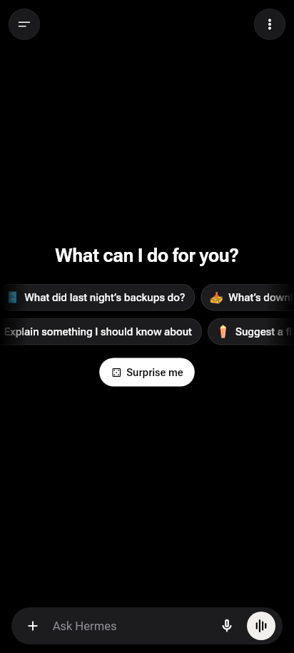
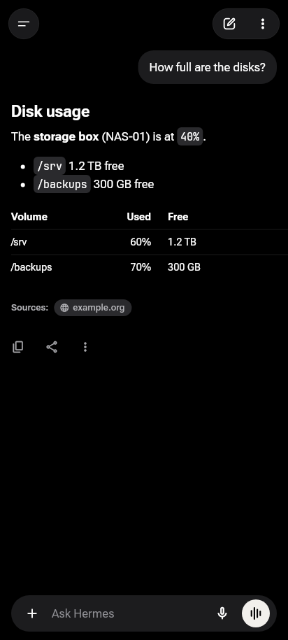
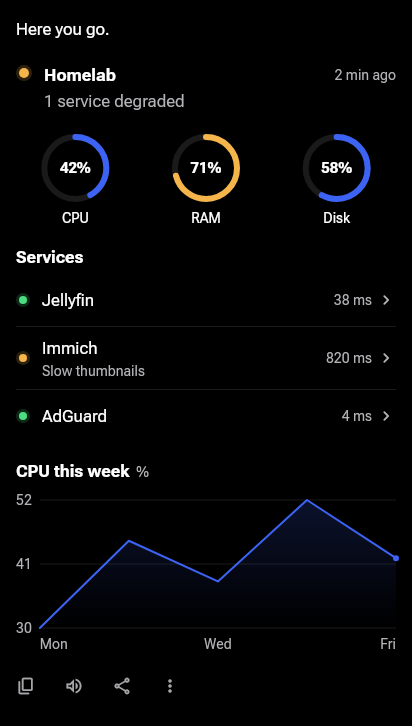
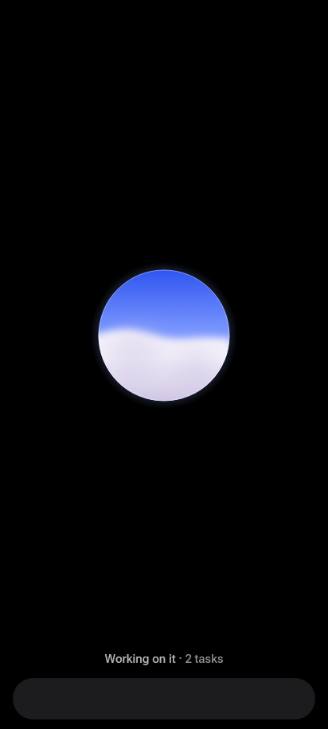

# Tove

Tove is a mobile, desktop and web app for your own self-hosted
[Hermes Agent](https://github.com/NousResearch/hermes-agent). You chat with Hermes and get rich replies (cards,
tables, charts, checklists), talk to it in live voice calls, and hand it tasks that keep running after the call
ends. Everything goes to a server you run; there is no Tove cloud and no account.

> **Status: early development.** The Android app is released as a signed APK on
> [GitHub Releases](https://github.com/itskavin/tove/releases) only (not on Google Play). The bridge API and the app can
> still change between versions.

## Screenshots

<p>
  
  
  
  
</p>

These are rendered by the app's widget tests with sample data, not taken from a device.

## Features

- **Chat with Hermes.** Streaming replies that survive a dropped connection, chat history and search, reply effort
  (instant, medium, high), stop and retry, attachments (photos, PDFs, text and office files), web search when
  Hermes has it.
- **Rich replies.** Hermes can answer with [OpenUI](https://github.com/thesysdev/openui) components (cards, tables,
  tabs, charts, gauges, checklists, comparisons, itineraries) that Tove draws with its own native widgets, plus
  markdown with tables, code, footnotes, link previews and pictures.
- **Live voice.** Tap the orb and talk. Audio goes directly between your device and the voice model over WebRTC; the
  bridge only sets the call up. Voice runs on GPT-Live, either through your own ChatGPT login (Codex CLI) or your own
  OpenAI API key, both kept on your server.
- **Tasks.** Ask for something during a call and Hermes works on it in the background with its real tools. Results
  come back into the call and into the chat, and tasks that outlive the call still finish.
- **Notifications.** Tove tells you when a reply or a task is done, through a connection to your own bridge (no
  Google push service). UnifiedPush through ntfy also works.
- **Android extras.** Home-screen widgets ("Ask Tove", shortcuts), a call notification with mute and hang-up, and
  on-device dictation and read-aloud voices (optional downloads).
- **Synced settings.** Theme, voice, custom instructions and profile follow you across devices through your bridge.

Targets: Android, iOS, Linux, macOS, Windows and the web. Android is the most tested; iOS builds need a Mac and have
not been tested on a device.

## How it works

```
┌──────────────┐  HTTPS + access key   ┌──────────────┐  OpenAI-compatible API   ┌──────────────┐
│   Tove app   │ ─────────────────────▶│ Tove bridge  │ ────────────────────────▶│ Hermes Agent │
│ (your phone, │                       │ (server/,    │                          │ (your server)│
│  PC, browser)│                       │  Python)     │ ── sets up voice calls ─▶ GPT-Live      │
└──────┬───────┘                       └──────────────┘                          └──────────────┘
       │            WebRTC audio, directly between the device and the voice model
       └──────────────────────────────────────────────────────────────────────────▶ GPT-Live
```

- **The app** talks only to the bridge, over HTTPS, with one access key.
- **The bridge** (`server/gpt-live-bridge.py`) runs next to Hermes. It keeps the chat history (SQLite), forwards
  chats to Hermes' API server, stores attachments, and brokers live voice sessions. It holds every credential:
  Hermes' API key and your ChatGPT login or OpenAI key never reach the app.
- **Hermes Agent** does the actual work: the model, memory, tools and skills are all Hermes'.

The wire contract between app and bridge is [server/API.md](server/API.md).

## Quick start

You need [Hermes Agent](https://hermes-agent.nousresearch.com/docs/getting-started/installation) running on a Linux
machine. Tove's server, the bridge, runs next to it, and Hermes can install it for you.

1. **Get the app** on your Android phone: download the latest APK from the
   [GitHub Releases page](https://github.com/itskavin/tove/releases) and install it. (Other platforms: see
   [Building from source](#building-from-source).)
2. **Ask Hermes to set Tove up.** Install the skill once:

   ```sh
   hermes skills install itskavin/tove/hermes-skill/tove-setup
   ```

   then tell Hermes (in its terminal, on Telegram or in any of its chats): **"set up Tove"**. It checks the machine,
   asks how your phone should reach it (Tailscale is the private, recommended way), installs the bridge with a new
   access key, and turns on Hermes' API server if you agree.
3. **Scan the QR code** Hermes shows (on Telegram it sends a picture) with Tove's **Scan QR code** button. Or tap
   **Enter code or address** and type the address and the short code. The code works once, for 10 minutes. Tove
   connects and opens the chat.

Lost the connection, or adding a second phone? Ask Hermes to "pair Tove again". What the skill does and its limits:
[hermes-skill/README.md](hermes-skill/README.md).

### Install by hand

With Docker, on the machine where Hermes runs (Hermes' API server on, as in
[its docs](https://hermes-agent.nousresearch.com/docs/user-guide/features/api-server)):

```sh
git clone https://github.com/itskavin/tove.git && cd tove/server
docker build -t tove-bridge .
mkdir -p ~/tove-data
cp bridge.env.example ~/tove-bridge.env && chmod 600 ~/tove-bridge.env
python3 -c "import secrets; print(secrets.token_urlsafe(32))"      # paste as LIVE_PAGE_KEY
# In ~/tove-bridge.env set LIVE_PAGE_KEY, HERMES_API_KEY (the API_SERVER_KEY in ~/.hermes/.env) and BRIDGE_HOST=127.0.0.1
docker run -d --name tove-bridge --restart unless-stopped --network host \
  --env-file ~/tove-bridge.env -v ~/tove-data:/data --user "$(id -u):$(id -g)" \
  --read-only --tmpfs /tmp --cap-drop ALL --security-opt no-new-privileges:true tove-bridge
tailscale serve --bg --https=8787 http://127.0.0.1:8787            # or your own HTTPS reverse proxy
docker exec tove-bridge python /app/tove_pair.py --url https://YOUR-MACHINE.YOUR-TAILNET.ts.net:8787
```

The last command prints the pairing QR code and code. The app only accepts HTTPS addresses. For voice, log the
bridge in to ChatGPT (`docker exec -it tove-bridge codex login --device-auth`) or set `OPENAI_API_KEY`. The full
guide, with the Python (no Docker) install, voice, attachments, notifications, backups and troubleshooting, is
[server/SELF-HOSTING.md](server/SELF-HOSTING.md).

## Building from source

The app is a standard Flutter project in `app/` (Flutter 3.50, Dart 3.14).

```sh
cd app
flutter pub get
flutter analyze
flutter test -j 1
flutter build apk --debug                    # installable test build
flutter build web --release --base-href /app/ --no-web-resources-cdn --no-wasm-dry-run
python3 -I tool/web_fallback_fonts.py --web-dir build/web --fetch   # self-hosted fallback fonts
```

A release APK must be signed with your own key: point `TOVE_KEY_PROPERTIES` at a `key.properties` file (or create
`app/android/key.properties`, which is gitignored). Release builds never fall back to the debug key. The details,
plus the build script that records build evidence and scans outputs for bridge secrets, are in
[app/README.md](app/README.md) and [app/docs/native-call-integration.md](app/docs/native-call-integration.md).

The bridge's tests use only the standard library's `unittest` and the bridge's own dependencies:

```sh
cd server
python3.12 -m venv venv && venv/bin/pip install -r requirements.txt
venv/bin/python -m unittest discover -p 'test_*.py'
```

## Installing and updating the app

**Install (Android).** Download the latest `tove-*.apk` from the
[Releases page](https://github.com/itskavin/tove/releases/latest) and open it; allow installing from your browser
when Android asks. Android warns about apps from "unknown sources" for every app that does not come from an app
store; the warning is not about Tove in particular. Every release is signed with the same key, so only genuine updates
install over it.

**Updates.** Tove checks the Releases page once a day and shows the new version's notes with a **Download** button,
which opens the APK in your browser; open it to update (your chats and settings stay). Check by hand, or turn the daily
check off, in Settings › About › Updates. The check asks GitHub's public API only and sends nothing about you.

**Releases** are tagged `vX.Y.Z+N`, the app's version and build number; the steps are in
[app/README.md](app/README.md#releasing).

## Privacy and safety

- **Your server, your data.** Chats, uploads and settings are stored by your bridge. The app has no analytics,
  tracking or third-party services of its own. Live voice audio goes from your device to the voice service your
  bridge uses.
- **One key, kept safe.** The app holds only the bridge's access key, in the platform's secure storage (Keychain,
  Android encrypted storage, libsecret, Windows Credential Manager; on the web an encrypted browser store, which is
  obfuscation rather than a hardware keystore).
- **Model output is data, not code.** There is no WebView. Markdown, HTML-like and OpenUI replies are parsed and drawn
  with native widgets; nothing in a reply runs as code. OpenUI actions can only send a visible message, copy text,
  change the block's own state, or open a link after a confirm sheet (http, https, mailto, and tel: or geo: from
  place cards, which open the dialer or maps app without calling).
- **Location is opt-in and coarse.** "Use my approximate location" is off by default. When on, each message carries
  a position rounded to about 1 km; the bridge keeps only a one-line label with the message. Local places come from
  open data on your own server (Overture Maps, OpenStreetMap), with no Google key. Maps load OpenStreetMap tiles.
- **Pictures and links go through the bridge.** The bridge fetches link previews and images itself, refuses private,
  loopback and tailnet addresses, and caps size and type, so a reply cannot make your phone contact arbitrary hosts.
- **Hermes has real tools.** Anyone with your access key can drive your Hermes Agent. Treat the key like an SSH key,
  and give the bridge a long random one (it refuses keys shorter than 24 characters).
- **One person per bridge.** A bridge has no user accounts. To set Tove up for someone else, run a separate bridge
  and Hermes for them ([SELF-HOSTING.md §8](server/SELF-HOSTING.md#8-setting-tove-up-for-someone-else)).

## Repository layout

| Path | What it is |
| --- | --- |
| `app/` | The Flutter app. Developer notes in [app/README.md](app/README.md), design notes in `app/docs/`. |
| `server/` | The bridge, its tests, the Docker setup and the optional Hermes image-search plugin. See [server/README.md](server/README.md). |
| `hermes-skill/` | The `tove-setup` Hermes skill, which installs the bridge and pairs the app. See [hermes-skill/README.md](hermes-skill/README.md). |
| `docs/screenshots/` | The images above. |

## Contributing

Issues and pull requests are welcome. Before you open a pull request:

- run `flutter analyze` and `flutter test -j 1` in `app/`, the bridge's unit tests in `server/`, and
  `python3 -m unittest discover -s hermes-skill` for the setup skill;
- format Dart code with `dart format`;
- if you change what a widget looks like, regenerate its goldens (`flutter test --update-goldens <test file>`) and
  check the new images;
- if you change the bridge API, update [server/API.md](server/API.md) and keep old app versions working (the app
  finds features through `GET /api/capabilities`);
- never commit keys, `bridge.env`, `key.properties` or screenshots that show your own data.

## Licence

Tove is free software under the [GNU General Public License v3.0 or later](LICENSE).

Third-party parts:

- `app/lib/src/ui/openui/lang/` is a Dart port of `@openuidev/lang-core` by Thesys Inc., MIT licence
  ([app/assets/licenses/OpenUI_LICENSE.txt](app/assets/licenses/OpenUI_LICENSE.txt)).
- Bundled fonts Roboto, Roboto Flex and JetBrains Mono are under the SIL Open Font License 1.1
  (licence files in [app/assets/fonts/](app/assets/fonts/)).
- Optional on-device speech models are downloaded at runtime under their own licences (Apache-2.0, MIT, CC BY); the
  app lists them on its licence page.

The app's licence page (Settings › About › Licences) shows all of these together with the licences of its Dart
packages.

## Notice

Tove is an independent project. It is not affiliated with, endorsed by or sponsored by OpenAI, Nous Research or
Hermès. "ChatGPT", "GPT-Live" and "OpenAI" are trademarks of OpenAI; "Hermes Agent" is a project of Nous Research.
